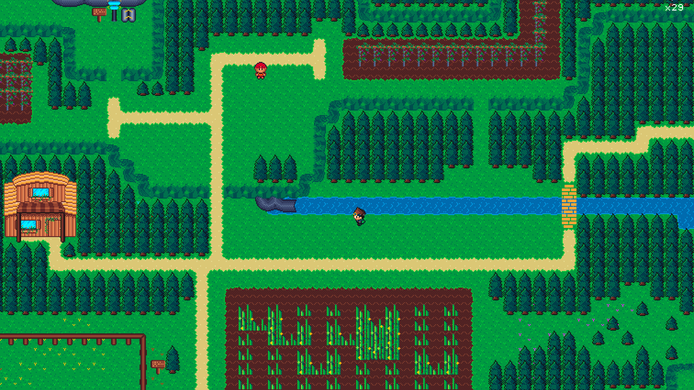
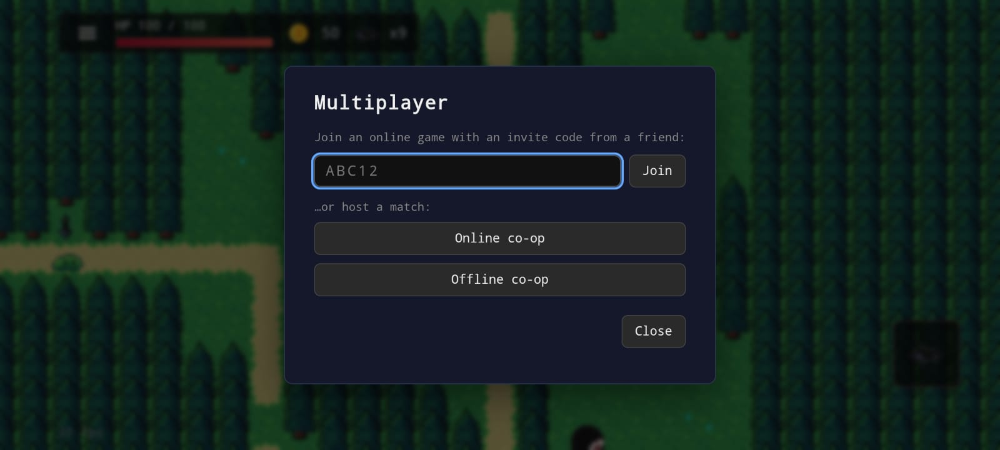
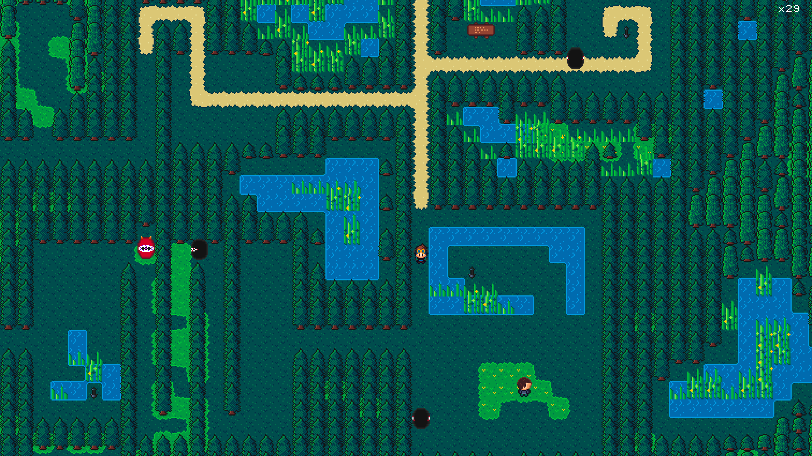
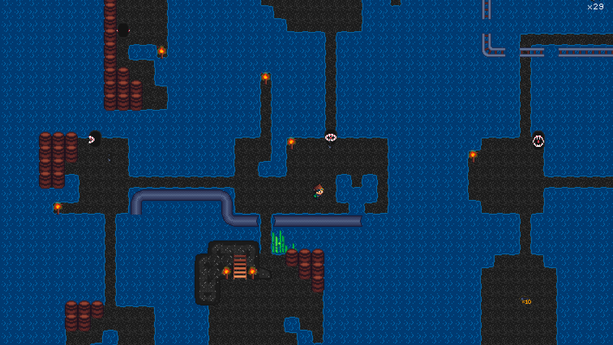
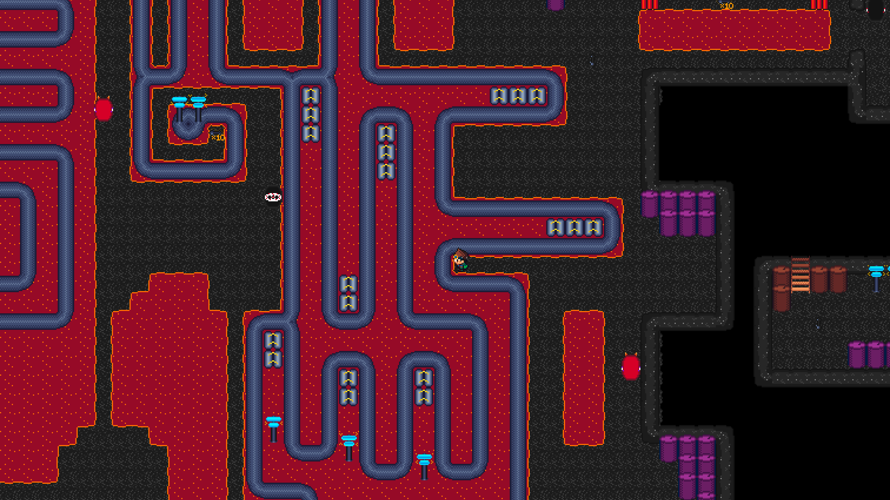
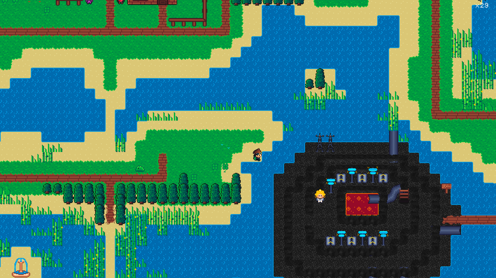

SneakBit is a top-down adventure-action game with close- and long-range combat, a hand-drawn Gameboy-style world, and a story to wander through. 


<div class="download-links noprint">
    <a href="https://sneakbit.curzel.it/" style="margin-right: 8px">
        
    </a>
    <a href="https://store.steampowered.com/app/3360860/SneakBit/" style="margin-right: 8px">
        
    </a>
    <a href="https://apps.apple.com/app/sneakbit/id6737452377" style="margin-right: 8px">
        
    </a>
    <a href="https://play.google.com/store/apps/details?id=it.curzel.bitscape">
        
    </a>    
</div>
<br>



## What's new in 2.0

* **Complete JavaScript rewrite** - the Rust core is gone; the whole game is now
  vanilla ES modules and Canvas 2D, running in the browser with no build step for
  development. (The old sources are still in this repo's history, at the
  `rust-core-tip` tag.)
* **Multiplayer** - host a match and share the invite code, or join a friend's.
  Online co-op runs peer-to-peer over WebRTC for up to four players; offline
  co-op puts up to four players on one machine, one controller each.



## Features

* Adventure-action gameplay with melee (sword) and ranged (kunai) combat
* Pre-rendered dual-layer tiling system - biomes, constructions, animated objects
* Free 8-way movement over a tile-based world (see [Movement model](#movement-model))
* **Online co-op** - up to four players share one world over WebRTC ([docs/multiplayer.md](docs/multiplayer.md))
* **Local Split Screen** - up to four players on one machine, one controller each
* Keyboard and gamepad/controller support

## Movement model

The world is tile-based — terrain, buildings, spawn points, pushable rocks and
the pathfinding grid all live on tiles — but bodies move freely over it.

* **Heroes** walk continuously in 8 directions at their species speed
  (`base_speed` × 1.125 tiles/s): held keys combine and diagonals are normalised,
  a gamepad stick or the touch joystick give analog speed. Positions are floats
  in tile units; `tileX/tileY` is the tile under the hitbox centre, which is what
  teleporters, pickups and cutscene triggers read. Sprites keep 4-way facing.
* **Collision** (`js/heroCollision.js`): a 0.6-tile hitbox against the tile grid
  (biome/construction obstacles, rigid entities, closed gates), resolved per axis
  so the hero slides along walls and is nudged around corners it only clips.
  Walking into a rock shoves it one tile. On ice the hero slides in a straight
  line until it hits something or leaves the ice.
* **Monsters** (`js/mobs.js`) that see a hero steer straight at it, slide along
  walls and follow a grid path when blocked; on contact they bump and recoil.
  Wandering stays tile-stepped.
* **Separation** (`js/separation.js`): players drift apart and monsters are
  shoved out of players, so a crowd can surround one target.
* **Combat and interaction**: the sword hits an arc in front of the hero, kunai
  fly from the hero's position in its facing, and talking works by proximity and
  facing.
* **Online co-op**: each guest streams its own position; the host validates and
  applies it ([docs/multiplayer.md](docs/multiplayer.md)).

## Running it

No build step for development - serve the folder with any static HTTP server
(browsers block `fetch` on `file://`) and it loads the raw ES modules straight
from `js/`:

```bash
npm run serve            # node tools/serve.mjs (port 8000) - always the source tree
npm run serve -- --build # the _site/ bundle instead, when that is the point
# or
npx http-server -p 8000
```

Then open <http://localhost:8000>.

Production *is* bundled: `npm run build` (esbuild) writes content-hashed,
code-split bundles into `_site/`. That's what ships - the public build at
<https://sneakbit.curzel.it> is deployed from the VPS via `npm run deploy`, and the
desktop and mobile builds package the same `_site/`. Plain dev runs and the e2e
harness never touch the bundle.

## Tests

```bash
npm run test:unit        # fast inner loop (~2 s) - node --test
npm run test:e2e         # full e2e suite (~26 s; needs Chrome)
npm test                 # both, sequential
```

Unit tests use Node's built-in test runner. E2E tests drive headless Chrome via raw
CDP and self-skip if Chrome isn't on the path. Run `npm ci` first:
`tests/steamPackaging.test.js` checks the Linux launcher installed from
`@curzel-it/steam-tools`.

## Credits

* Art, design, and original code by [Federico Curzel](https://github.com/curzel-it)
* Music by [Filippo Vicarelli](https://www.filippovicarelli.com/8bit-game-background-music)
* Sound effects by [SubspaceAudio](https://opengameart.org/content/512-sound-effects-8-bit-style)
* Font by [HarvettFox96](https://dl.dafont.com/dl/?f=pixel_operator)

## Contributing

PRs welcome - see [CONTRIBUTING.md](./CONTRIBUTING.md) and [CODE_OF_CONDUCT.md](./CODE_OF_CONDUCT.md).

## License

[MIT](./LICENSE) for the code in this repo. Third-party assets keep their original licenses (see Credits above).

## More screenshots
 

 

